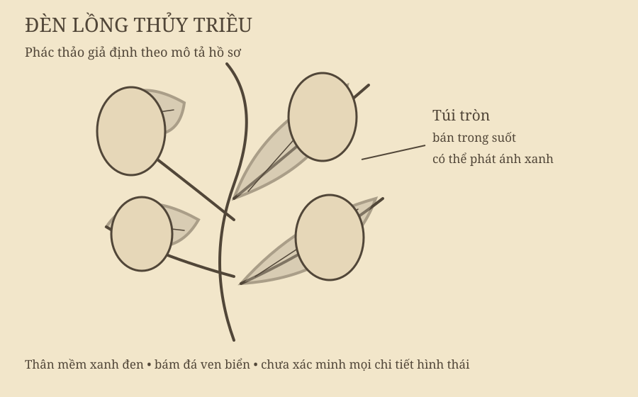
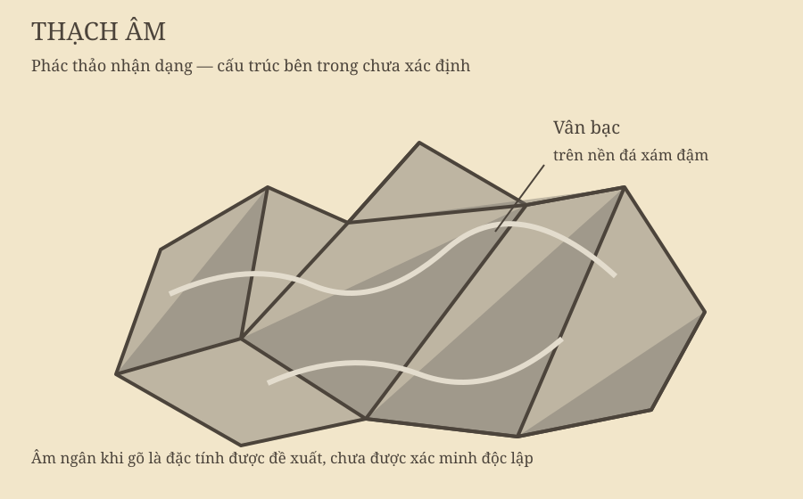
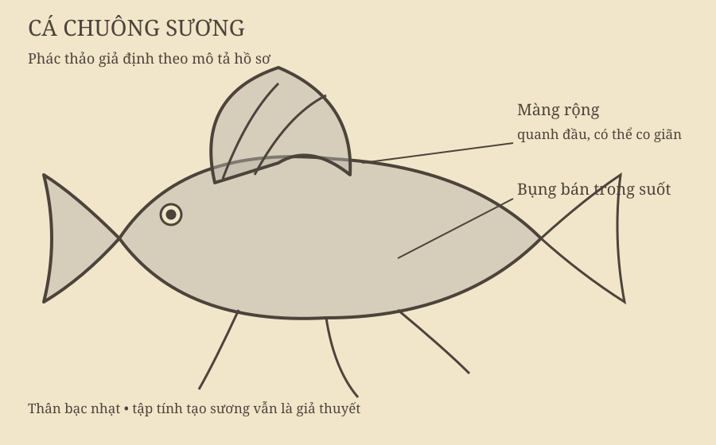

# Ngày 001 — Những thứ tưởng như vô hại

> Tác giả: Giáo sư Ezekiel Sycamore  
> Mã lưu trữ: SS-SYC-D001  
> Bài giảng thực địa · Ba mẫu vật  
> Công bố chính thức

Đây là bài giảng mở đầu trong bộ ghi chép tự nhiên học về Shattered Seas. Ba mẫu vật dưới đây được ghi nhận trong công bố chính thức của Giáo sư Sycamore. Cần phân biệt điều đã được quan sát và xác lập trong hồ sơ với những giả thuyết về cơ chế, tập tính, công dụng hoặc nguy cơ. Việc một giả thuyết được công bố không biến nó thành chân lý đã được chứng minh.

## I. Thực vật — Đèn Lồng Thủy Triều

**Tên học thuật đề xuất:** *Luminaria tidalensis*  
**Phân loại:** Thực vật ven biển, được giả định có khả năng phát quang.  
**Môi trường được đề xuất:** Vịnh nước nông, hang ven biển và vùng thủy triều có dòng chảy ổn định.

### Mô tả

Đây là loài cây bám đá, thân mềm màu xanh đen, mọc ra những túi tròn bán trong suốt. Theo mô tả được ghi nhận, các túi có thể phát ánh sáng xanh lam khi trời tối và tăng sáng trong thời gian ngắn khi chịu tác động của dòng nước.

### Công dụng tiềm năng

Có thể nghiên cứu loài này để tìm hiểu hiện tượng phát quang sinh học và phản ứng với kích thích. Nếu đặc tính phát sáng được xác minh, nó có thể hữu ích trong việc đánh dấu lối đi ven hang hoặc vùng nước nông, cũng như phát triển đèn báo hiệu sinh học.

### Nguy cơ và lưu ý an toàn

Dịch tiết từ các túi có thể gây kích ứng, nhưng điều này chưa được xác minh. Không chạm, nghiền hoặc lấy dịch từ mẫu vật khi chưa tiến hành kiểm tra an toàn.

### Ghi chú của Sycamore

“Ánh sáng đẹp thường khiến con người quên mất việc phải cảnh giác. Nếu nhìn thấy một vùng nước phát sáng, đừng vội bước xuống. Hãy quan sát xem ánh sáng có phản ứng với chuyển động của mình không.”

**Mức độ xác nhận:** Sự tồn tại và mô tả nhận dạng của Đèn Lồng Thủy Triều được xác lập trong công bố này. Cơ chế phát sáng, công dụng và nguy cơ vẫn là giả thuyết hoặc khả năng cần kiểm tra.

**Mã hồ sơ:** `SS-SYC-D001-PL01`  
**Từ khóa:** Ven biển · Phát quang · Sinh thái · Giả thuyết

## II. Khoáng vật — Thạch Âm

**Tên học thuật đề xuất:** *Resonita obscura*  
**Phân loại:** Khoáng vật.  
**Môi trường được đề xuất:** Tầng đá sâu, vách núi, hang động và các khe nứt địa chất.

### Mô tả

Thạch Âm có màu xám đậm hoặc gần đen, thường được mô tả với những đường vân bạc. Một số mẫu được cho là phát ra tiếng ngân khi bị gõ. Độ ngân và âm sắc có thể khác nhau tùy cấu trúc bên trong hoặc tình trạng vết nứt của mẫu đá.

### Công dụng tiềm năng

Nếu đặc tính cộng hưởng được xác minh, Thạch Âm có thể trở thành đối tượng nghiên cứu về cộng hưởng vật liệu. Những ứng dụng được đề xuất gồm thiết bị báo rung, truyền tín hiệu hoặc kiểm tra khiếm khuyết vật liệu.

### Nguy cơ và lưu ý an toàn

Mẫu đá có vết nứt có thể vỡ thành những mảnh sắc. Không đập thử bằng tay và không thu thập các mẫu chưa ổn định.

### Ghi chú của Sycamore

“Âm thanh không phải lúc nào cũng là câu trả lời; đôi khi nó chỉ là lời cảnh báo. Đừng xem kinh nghiệm của người thợ mỏ là mê tín chỉ vì họ chưa giải thích được bằng thuật ngữ của các em.”

**Mức độ xác nhận:** Thạch Âm và mô tả nhận dạng được xác lập trong công bố này. Cơ chế cộng hưởng, các ứng dụng và nguy cơ cụ thể vẫn là giả thuyết hoặc khả năng chưa được xác nhận.

**Mã hồ sơ:** `SS-SYC-D001-MN01`  
**Từ khóa:** Địa chất · Cộng hưởng · Vật liệu · Giả thuyết

## III. Động vật — Cá Chuông Sương

**Tên học thuật đề xuất:** *Nebulacampana pelagica*  
**Phân loại:** Sinh vật biển.  
**Môi trường được đề xuất:** Vùng biển lạnh, vịnh sương, vùng nước sâu và nơi có độ mặn thay đổi.

### Mô tả

Cá Chuông Sương được mô tả là sinh vật có thân bạc nhạt, phần bụng bán trong suốt và một lớp màng rộng quanh đầu, có thể co giãn. Khi bị kích thích, sinh vật có thể tạo ra một màn sương mỏng quanh cơ thể. Một giả thuyết cho rằng màn sương này hình thành từ nước biển kết hợp với dịch nhầy do cơ thể tiết ra.

### Tập tính được đề xuất

Sinh vật có thể sống theo nhóm nhỏ, sử dụng màn sương để che giấu hướng di chuyển và nhạy cảm với rung động trong nước. Chúng cũng có thể tập trung tại những nơi nguồn thức ăn dồi dào. Tất cả những nhận định về tập tính này vẫn cần được quan sát và kiểm chứng thêm.

### Công dụng tiềm năng

Cá Chuông Sương có thể là đối tượng nghiên cứu về ngụy trang, tuyến tiết và khả năng thích nghi với vùng biển lạnh. Giá trị làm thực phẩm chưa được xác minh.

### Nguy cơ và lưu ý an toàn

Màn sương có thể làm giảm tầm nhìn của thủy thủ. Thành phần dịch tiết chưa rõ, vì vậy cần tránh hít hoặc tiếp xúc trực tiếp.

### Ghi chú của Sycamore

“Tôi không sợ những sinh vật lớn. Tôi sợ những sinh vật khiến tôi không còn biết thứ gì đang ở trước mặt mình. Thứ không nhìn thấy không đồng nghĩa với thứ không tồn tại.”

**Mức độ xác nhận:** Cá Chuông Sương và mô tả nhận dạng được xác lập trong công bố này. Tập tính, cơ chế tạo sương, nguy cơ và công dụng vẫn là giả thuyết hoặc đề xuất chưa được xác minh.

**Mã hồ sơ:** `SS-SYC-D001-AN01`  
**Từ khóa:** Sinh vật biển · Ngụy trang · Sương · Giả thuyết

## IV. Tổng kết bài giảng

Ba mẫu vật hôm nay nhắc chúng ta về ba nguyên tắc nền tảng của nghiên cứu thực địa.

**Quan sát trước khi chạm.** Màu sắc, chuyển động, âm thanh và phản ứng là dữ liệu ban đầu. Đừng để sự tò mò khiến các em bỏ qua bước quan sát.

**Tách sự thật khỏi giả thuyết.** Lời kể, quan sát trực tiếp và suy luận phải được ghi nhận riêng. Một giả thuyết tốt vẫn chỉ là giả thuyết cho đến khi có bằng chứng đủ mạnh.

**An toàn trước khám phá.** Không mẫu vật nào đáng giá bằng mạng sống của người nghiên cứu.

### Câu hỏi dành cho học viên

1. Vì sao không nên chạm vào Đèn Lồng Thủy Triều dù nó có vẻ vô hại?
2. Nếu Thạch Âm tạo ra những âm thanh khác nhau, các em sẽ thiết kế phép thử nào để kiểm tra nguyên nhân?
3. Khi gặp một đàn Cá Chuông Sương, việc đầu tiên cần làm là gì? Vì sao?

---

*Giáo sư Ezekiel Sycamore — Công bố chính thức. Những điểm được ghi rõ là giả thuyết, khả năng, công dụng tiềm năng hoặc chưa xác minh phải tiếp tục được hiểu với đúng mức độ bất định ấy; không được diễn giải thành sự thật chắc chắn.*
