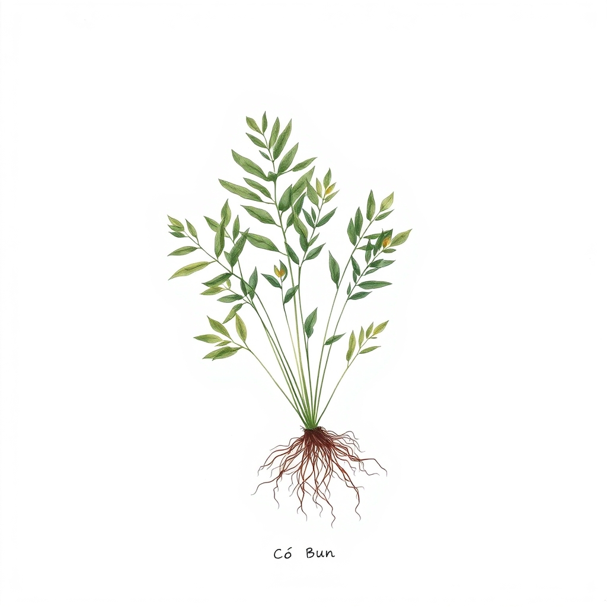
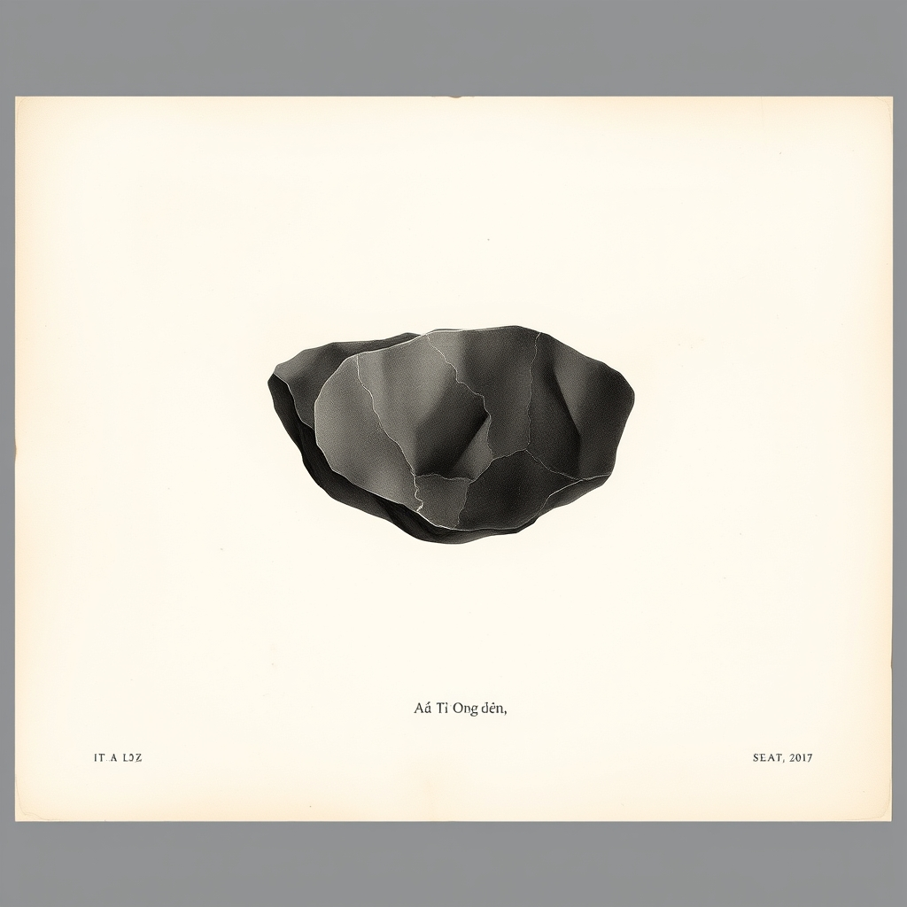
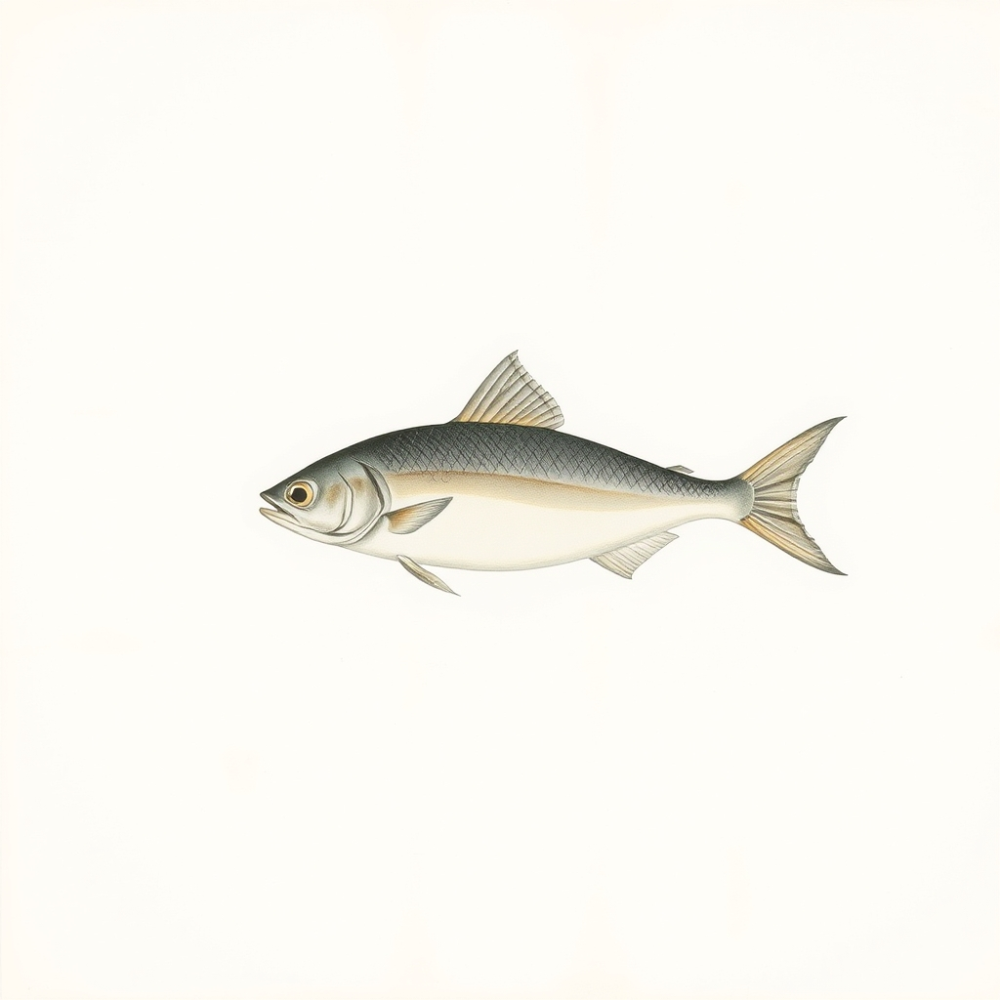

# Ngày 002 — Ba cách tồn tại ở rìa khắc nghiệt

> Ngày công bố: 26-11-2026  
> Tác giả: Giáo sư Ezekiel Sycamore  
> Mã bài giảng: SS-SYC-D20261126  
> Công bố chính thức · Ba mẫu vật

Hôm nay, chúng ta đi qua ba ranh giới rất khác nhau: bãi bùn và vùng đất ẩm của Dreadwater, vách đá bazan của Tempest Expanse, rồi mép nước lạnh nơi băng trôi gặp biển. Ba mẫu vật không thuộc cùng một hệ sinh thái. Điều nối chúng lại là câu hỏi: một sinh vật hay một vật liệu giữ được đặc tính của mình như thế nào khi môi trường quanh nó luôn thay đổi?

## I. Thực vật — Cỏ Neo Bùn

**Mã hồ sơ:** `SS-SYC-20261126-PL01`  
**Tên học thuật:** *Anchora limicola*.  

**Địa điểm ghi nhận:** Rìa vùng đất ẩm tiếp giáp bãi bùn trên Fogbound Isle, thuộc Wreckers' Reach, Dreadwater.

### Nhận diện và hình thái

Cỏ Neo Bùn mọc thành những cụm thấp, lá hẹp và dài, màu xanh sẫm, có một đường gân nhạt chạy dọc giữa phiến. Phần gốc lá xếp sít quanh một thân ngắn. Khi vén lớp bùn mỏng, có thể thấy nhiều rễ nhỏ đan thành một búi nông, lan ngang hơn là cắm sâu.

### Đặc tính và vai trò sinh thái

Khi gió quất qua bãi trống, lá nghiêng sát mặt đất rồi dần dựng lại. Búi rễ giữ được một phần bùn quanh gốc khi nước rút. Điều này gợi ý cây có thể góp phần giữ lớp trầm tích nông, nhưng cần phép thử dài ngày trước khi xem đó là một chức năng sinh thái đã được xác nhận.

### Công dụng, nguy cơ và cách xử lý

### Ghi chép thực địa

Robin Robinson báo cáo rằng mép bãi quanh các cụm cỏ có chỗ lún bất thường, dù bề mặt trông khá chắc. Tôi kiểm tra bằng một cây sào và xác nhận có những túi bùn mềm ngay dưới lớp váng mỏng. Khứu giác quá nhạy của tôi khiến mùi bùn hữu cơ ở đó trở nên khó chịu, nhưng phản ứng của riêng tôi tuyệt nhiên không phải bằng chứng rằng cây hay bùn có độc.

**Tag liên kết:** `region-dreadwater` · `island-fogbound` · `wet-lowland` · `mudflats` · `guild-terrestrial-primary-producers` · `process-island-production-loop`

## II. Khoáng vật / đá — Đá Tổ Ong Đen

**Mã hồ sơ:** `SS-SYC-20261126-MN01`  
**Tên định danh:** *Basaltum vesiculare* — tên ghi chép tạm cho mẫu bazan có cấu trúc lỗ rỗng, không phải tên của một loài khoáng vật mới.  

**Địa điểm ghi nhận:** Mảnh đá rời ở chân vách bazan và gần các vịnh cát đen trên Thunderhead Isle, Tempest Expanse.

### Nhận diện và đặc tính vật lý

Mẫu có nền màu xám đen đến đen, hạt mịn, xen những hốc tròn và hốc kéo dài không đều. Một số hốc thông ra bề mặt, số khác bị lớp đá mỏng che kín. Khi khô, mẫu nhẹ hơn một khối bazan đặc có kích thước tương tự; khi ướt, nước đọng lại trong vài hốc lớn.

Các cạnh vỡ sắc và một số phần rìa dễ bong thành mảnh nhỏ. Đây là mô tả của những mẫu tôi đã thu, không phải kết luận rằng mọi khối đá trên Thunderhead đều có cùng độ bền.

### Quá trình hình thành và khả năng ứng dụng

Nếu kiểm tra được độ bền và khả năng thoát nước, loại đá này có thể được thử làm lớp đệm thoát nước hoặc vật liệu chèn nhẹ. Không nên dùng làm cấu kiện chịu lực chỉ dựa trên trọng lượng của nó. Những hốc rỗng có thể khiến khả năng chịu nén thay đổi đáng kể.

### Nguy cơ và cách xử lý

Cạnh vỡ sắc có thể gây thương tích; mảnh rìa dễ bong có thể rơi bất ngờ. Không đứng dưới vách khi đang có sóng lớn, không lấy mẫu ở các rãnh nước dâng và luôn bọc riêng các mảnh đá trong túi vải dày hoặc hộp cứng. Không nghiền đá để hít bụi hay thử bằng cách đập trực tiếp vào tay.

### Ghi chép thực địa

Robin nhắc tôi tránh nhặt mẫu ngay sát mép nước: một đợt sóng dâng đã làm dịch chuyển những mảnh đá tưởng như nằm yên. Tôi lùi lên nền cao hơn rồi mới chọn mẫu rời. Một bài học đơn giản, nhưng vách đá không quan tâm người nghiên cứu đã đi bao xa để đến đó.

**Tag liên kết:** `region-tempest-expanse` · `island-thunderhead` · `basalt-cliffs` · `black-sand-coves` · `process-storm-redistribution` · `resource-basalt`

## III. Động vật — Cá Vây Kính

**Mã hồ sơ:** `SS-SYC-20261126-AN01`  
**Tên học thuật:** *Vitrofinis glacialis*.  

**Địa điểm ghi nhận:** Vùng nước lạnh ngoài rìa một cửa vịnh theo mùa gần Northern Ice Isle, Frostbound Sea, nơi nước mở tiếp giáp các mảng băng trôi.

### Nhận diện và hình thái

Cá Vây Kính có thân thon, hai bên ánh bạc, lưng sẫm hơn và đôi vây ngực mỏng gần như trong suốt. Khi nhìn nghiêng dưới ánh sáng yếu, đường viền vây gần như biến mất; phần thân vẫn phản chiếu một dải sáng mờ. Mắt tương đối lớn so với đầu, miệng nhỏ hướng chếch về phía trước.

Tên gọi chỉ mô tả vẻ ngoài của vây, không hàm ý chúng được cấu tạo từ thủy tinh hay vật liệu khoáng.

### Tập tính và vai trò sinh thái

### Công dụng, nguy cơ và cách xử lý

### Ghi chép thực địa

Robin Robinson báo cáo một đường nứt mới xuất hiện trên mảng băng phía trước khi nhóm cá đổi hướng. Tôi cũng quan sát được hai sự việc nối tiếp ấy, nhưng không thể kết luận cá phản ứng với tiếng nứt, rung động hay một thay đổi nào khác trong nước. Trình tự thời gian là manh mối để đặt câu hỏi, không phải bằng chứng cho câu trả lời.

**Tag liên kết:** `region-frostbound-sea` · `island-northern-ice` · `ice-edge` · `polar-pelagic` · `guild-small-consumers` · `process-ice-edge-pulse`

## IV. Tổng kết bài giảng

Cỏ Neo Bùn giữ nền bùn, Đá Tổ Ong Đen điều tiết nước và nhiệt trong hốc đá, còn Cá Vây Kính vận chuyển năng lượng giữa phù du và các loài săn mồi. Ba mẫu vật cùng tạo nên một chuỗi tương tác nối đất, đá và nước.

## Chuyên luận của Giáo sư

**Cỏ Neo Bùn.** Rễ già hóa gỗ ở lõi, rễ non đan ngang phía ngoài, tạo tấm neo phân tán lực kéo của triều. Hạt có vỏ nhám bám vào chân chim nước, giúp loài phát tán giữa các bãi bùn. Búi cỏ giữ trầm tích, tạo nơi trú cho giun, ốc và cua non.

**Đá Tổ Ong Đen.** Đây là bazan bọt: khí thoát khỏi dung nham khi dòng nóng tiếp xúc không khí biển lạnh, để lại mạng hốc lớn nhỏ. Hốc đá giữ nước triều, làm chậm thay đổi nhiệt và tạo vũng nhỏ cho ấu trùng. Đá nhẹ nhưng giòn, thích hợp làm lớp thoát nước chứ không làm cấu kiện chịu lực.

**Cá Vây Kính.** Tia vây ngực trong suốt giảm tán xạ ánh sáng; lưng sẫm hòa bóng băng khi nhìn từ trên, bụng bạc phản chiếu mặt nước khi nhìn từ dưới. Đàn tách thành nhóm nhỏ khi có bóng chim săn rồi hợp lại dưới băng. Chúng ăn phù du và giáp xác nổi, là mắt xích thức ăn quan trọng của vùng băng rìa.

## Câu hỏi dành cho học viên

2. Những phép thử nào cần có trước khi dùng Đá Tổ Ong Đen làm vật liệu xây dựng?
3. Dữ kiện nào còn thiếu để chứng minh Cá Vây Kính thực sự phản ứng với tiếng nứt của băng?

---
