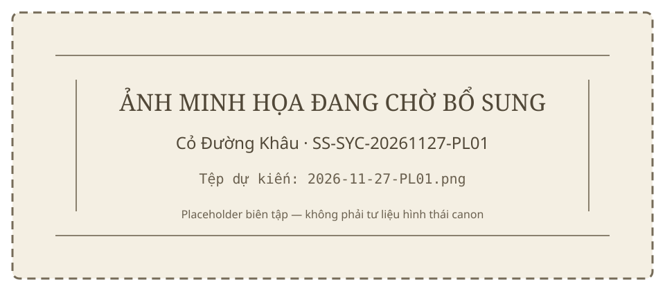
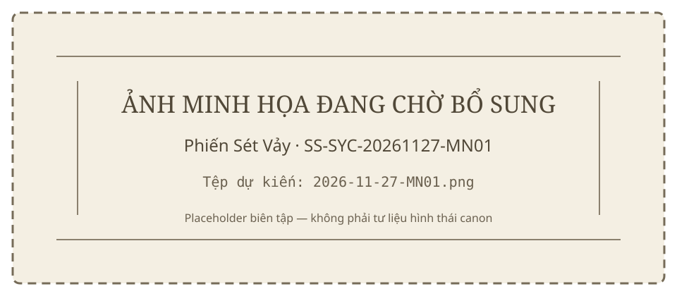
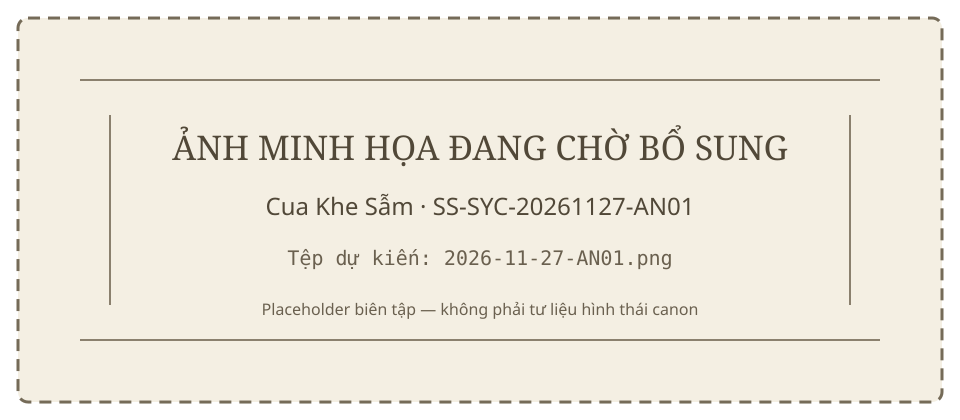

# Ngày 003 — Ba chiến lược bên mép nước

> Ngày công bố: 27-11-2026  
> Tác giả: Giáo sư Ezekiel Sycamore  
> Mã bài giảng: SS-SYC-D20261127  
> Công bố chính thức · Ba mẫu vật

Hôm nay, tôi chọn ba ghi nhận ở những nơi nước và đất không ngừng đổi chỗ cho nhau: một dải cát cao bị gió quét, một bờ trầm tích lộ ra sau khi nước rút, và những vũng nước nhỏ nằm giữa đá. Chúng không cùng một loài, cũng không cùng một vật liệu. Nhưng cả ba cho ta thấy cách hình thái có thể giúp một sinh vật hoặc một chất nền tồn tại trong môi trường thường xuyên bị xáo trộn.

Địa điểm cụ thể của các ghi nhận mới này chưa được đối chiếu đầy đủ với atlas. Tôi chỉ ghi vùng khảo sát là Dreadwater; không dùng tên đảo hoặc tọa độ chưa xác lập.

## I. Thực vật — Cỏ Đường Khâu

> **Ảnh minh họa:** ẢNH MINH HỌA ĐANG CHỜ BỔ SUNG — Cỏ Đường Khâu · `SS-SYC-20261127-PL01` · Tệp dự kiến: `2026-11-27-PL01.png`. Placeholder không phải hình thái canon.

**Mã hồ sơ:** `SS-SYC-20261127-PL01`  
**Tên học thuật đề xuất:** *Stichorhiza littoralis* — tên tạm do tôi đề xuất, chưa được thẩm định.  
**Phân loại:** Thực vật thân thảo ven biển; họ và chi chưa xác định.  
**Môi trường sống:** Dải cát cao, đất cát pha sỏi ở bờ biển Dreadwater; địa điểm cụ thể chưa đối chiếu atlas.

### Nhận diện và hình thái

Cỏ Đường Khâu mọc thành cụm thấp, các phiến lá hẹp, hơi gấp dọc và nghiêng theo chiều gió. Phần gốc lá ôm quanh một thân ngắn. Khi quan sát lớp cát quanh cụm cây, tôi thấy những rễ nhỏ tỏa thành mạng nông, một số đoạn nối các cụm gần nhau bằng thân ngầm ngắn. Trên vài cụm có cuống khô mảnh mang hạt nhỏ; tôi chưa quan sát đủ để xác định chu kỳ ra hoa hoặc thời điểm hạt chín.

### Đặc tính và vai trò sinh thái

Lá bị gió ép sát mặt cát nhưng không dễ gãy; sau khi gió dịu, chúng dần dựng trở lại. Những cụm cây giữ một lượng cát nhỏ quanh gốc. Điều này gợi ý mạng rễ và thân ngầm có thể góp phần hạn chế cát dịch chuyển, nhưng chưa có phép đo để khẳng định mức độ giữ cát hoặc khả năng phục hồi của quần thể.

### Công dụng và nguy cơ

Có thể nghiên cứu loài này trong phục hồi dải cát hoặc làm vật liệu sợi thử nghiệm. Chưa có thử nghiệm độ bền, độc tính hay khả năng trồng nhân rộng; không xem nó là cây chắn cát hiệu quả đã được chứng minh.

Cát quanh các cụm cây có thể che hốc rỗng hoặc nền bị xói. Đừng bước lên vùng cát mới bồi chỉ vì nó trông bằng phẳng, và không nhổ cây để kiểm tra toàn bộ mạng rễ nếu chưa ghi lại vị trí.

### Ghi chép thực địa

Tôi đặt một mẩu vỏ sò cạnh cụm cỏ để quan sát mức cát bị gió đẩy qua. Sau một khoảng theo dõi, cát dồn quanh gốc nhiều hơn phía ngoài, nhưng một phép quan sát đơn lẻ không đủ tách tác động của cây khỏi hướng gió và hình dạng nền cát. Các em hãy học cách ghi cả những yếu tố có thể làm sai lệch kết quả.

### Mức độ xác nhận

- **CANON:** Tôi ghi nhận trực tiếp cụm cỏ, hình thái lá, rễ nông và phản ứng của lá trước gió tại điểm khảo sát.
- **HYPOTHESIS:** Mạng rễ/thân ngầm có thể giữ cát; loài có thể hữu ích cho nghiên cứu phục hồi bờ cát hoặc sợi thực vật.
- **UNKNOWN:** Danh pháp chính thức, họ/chi, sinh sản, độ bền sợi, độc tính, mức đóng góp thực tế vào ổn định cát và phân bố rộng hơn.

**Tags:** `region-dreadwater` · `coastal-sand` · `wind-exposure` · `terrestrial-primary-producer` · `sediment-retention-hypothesis`

## II. Đá — Phiến Sét Vảy

> **Ảnh minh họa:** ẢNH MINH HỌA ĐANG CHỜ BỔ SUNG — Phiến Sét Vảy · `SS-SYC-20261127-MN01` · Tệp dự kiến: `2026-11-27-MN01.png`. Placeholder không phải hình thái canon.

**Mã hồ sơ:** `SS-SYC-20261127-MN01`  
**Tên định danh mô tả đề xuất:** *Argillite lamellaris* — nhãn mô tả tạm, không phải tên khoáng vật mới.  
**Phân loại:** Đá trầm tích hạt mịn, có vẻ giàu vật liệu sét; chưa phân tích khoáng vật.  
**Môi trường ghi nhận:** Một bờ trầm tích thấp lộ ra sau khi nước rút tại vùng khảo sát Dreadwater; vị trí cụ thể chưa đối chiếu atlas.

### Nhận diện và đặc tính vật lý

Các mảnh có màu xám xanh đến xám nâu, bề mặt mịn khi ẩm và xuất hiện những lớp mỏng gần song song. Một số mảnh tách thành phiến khi khô; ở trạng thái ẩm, cạnh phiến mềm và dễ biến dạng nếu ấn mạnh. Màu sắc thay đổi theo độ ẩm, vì vậy không nên dùng màu của mẫu ướt làm tiêu chí duy nhất để nhận dạng.

### Quá trình và vai trò địa chất

Cấu trúc lớp gợi ý vật liệu trầm tích được lắng đọng theo từng đợt, nhưng hình dạng lớp không tự xác định môi trường lắng, tuổi hoặc thành phần. Tôi chưa làm phép thử hạt, độ cứng, phản ứng hóa học hay phân tích khoáng vật. Nhãn “đá giàu sét” vẫn là nhận dạng sơ bộ.

### Công dụng và nguy cơ

Có thể khảo sát khả năng dùng làm nguyên liệu gốm, chất màu hoặc vật liệu phủ sau khi phân tích thành phần và thử nghiệm. Không khuyến nghị ứng dụng nào ở thời điểm này.

Mảnh phiến khô có thể vỡ cạnh sắc; bờ trầm tích ẩm dễ trượt hoặc sụp. Tránh lấy mẫu dưới mép bờ đang nứt, không nghiền mẫu khô trong không gian kín và rửa tay sau khi xử lý.

### Ghi chép thực địa

Tôi đặt một mảnh khô và một mảnh ẩm cạnh nhau. Mảnh ẩm dễ uốn cong nhẹ ở mép nhưng không thể xem đây là phép đo độ dẻo; độ dày và cấu trúc lớp khác nhau. Tôi ghi lại sự khác biệt để thiết kế thử nghiệm có kiểm soát, thay vì kết luận rằng mọi mẫu đều mềm khi gặp nước.

### Mức độ xác nhận

- **CANON:** Các mảnh đá có màu, bề mặt mịn và cấu trúc lớp như mô tả được quan sát tại bờ trầm tích.
- **HYPOTHESIS:** Nhận dạng sơ bộ là đá giàu sét; cấu trúc lớp có thể phản ánh các đợt lắng đọng.
- **UNKNOWN:** Thành phần khoáng vật, tuổi, nguồn trầm tích, khả năng dùng làm gốm/chất màu và độ bền.

**Tags:** `region-dreadwater` · `sedimentary-rock` · `clay-rich-hypothesis` · `stratification` · `shoreline`

## III. Động vật — Cua Khe Sẫm

> **Ảnh minh họa:** ẢNH MINH HỌA ĐANG CHỜ BỔ SUNG — Cua Khe Sẫm · `SS-SYC-20261127-AN01` · Tệp dự kiến: `2026-11-27-AN01.png`. Placeholder không phải hình thái canon.

**Mã hồ sơ:** `SS-SYC-20261127-AN01`  
**Tên học thuật đề xuất:** *Cavichirura obscura* — tên tạm, chưa được thẩm định.  
**Phân loại:** Động vật giáp xác, dạng cua; họ và chi tự nhiên chưa xác định.  
**Môi trường sống:** Vũng triều và khe đá ở một dải bờ đá Dreadwater; điểm khảo sát chưa được đối chiếu atlas.

### Nhận diện và hình thái

Cua Khe Sẫm có mai thấp, màu nâu sẫm pha xám, với các chấm nhạt không đều. Hai càng hướng ra phía trước; một càng trông lớn hơn nhưng tôi chưa đo để xác nhận chênh lệch. Các chân đi mảnh, mắt đặt trên cuống ngắn. Khi nằm sát đá, màu mai khiến đường viền khó phân biệt với nền ẩm và vỏ vụn.

### Đặc tính, hành vi và sinh thái

Tôi quan sát thấy cá thể lùi vào khe khi bóng người phủ qua vũng nước, sau đó bò ngang ra khi vùng sáng trở lại. Một số cá thể cào hoặc nhặt mảnh vụn ở nền đá; chưa xác định thức ăn chính. Việc chúng chọn khe làm nơi ẩn nấp có thể liên quan đến tránh bị săn mồi hoặc giảm tác động của dòng nước, nhưng chưa có quan sát đủ để phân biệt.

### Công dụng và nguy cơ

Cua có thể là đối tượng nghiên cứu về ngụy trang nền và sử dụng khe trú ẩn ở vùng triều. Chưa xác minh giá trị thực phẩm hay độc tính.

Càng có thể kẹp đau; khe đá có thể chứa sinh vật khác hoặc cạnh sắc. Không đưa tay sâu vào khe, không bắt cua bằng tay trần, và tránh khảo sát khi sóng đang dâng.

### Ghi chép thực địa

Tôi ngồi cách vũng nước một khoảng và chờ thay vì cố bắt cá thể đầu tiên. Khi bóng của tôi rời khỏi đá, cua quay lại mép khe, dùng càng chạm nền vài lần rồi tiếp tục di chuyển. Có thể đó là tìm thức ăn, thăm dò nền hoặc hành vi khác; tôi không ghi một hành động đơn lẻ thành tập tính chắc chắn.

### Mức độ xác nhận

- **CANON:** Cua có mai thấp màu sẫm, chấm nhạt, càng và chân như mô tả; phản ứng lùi vào khe và hoạt động trên nền đá được quan sát trực tiếp.
- **HYPOTHESIS:** Màu mai hòa nền; khe là nơi tránh dòng nước hoặc kẻ săn mồi; hành động cào nền có thể là kiếm ăn.
- **UNKNOWN:** Danh pháp, phân loại sâu hơn, thức ăn, sinh sản, thiên địch, độc tính và giá trị thực phẩm.

**Tags:** `region-dreadwater` · `rocky-intertidal` · `crustacean` · `camouflage-hypothesis` · `crevice-refuge`

## IV. Tổng kết bài giảng

Cỏ Đường Khâu, Phiến Sét Vảy và Cua Khe Sẫm cho thấy ba cách ứng phó với một bờ biển không ổn định: rễ bám và giữ vật liệu; lớp trầm tích ghi lại những lần thay đổi nhưng chưa tự kể được lịch sử; sinh vật nhỏ tìm khe trú ẩn, song ta vẫn chưa hiểu đầy đủ điều gì khiến nó chọn khe này thay vì khe khác.

Trong thực địa, hãy quan sát hình thái trước, ghi lại điều kiện môi trường, rồi mới đặt giả thuyết. Đừng để một vẻ ngoài hợp lý thay thế phép đo. Nếu chưa biết tên, hãy dùng tên mô tả. Nếu chưa biết công dụng, hãy ghi “chưa xác minh”. Cách viết thận trọng không làm nghiên cứu nghèo đi; nó giúp người đến sau biết chính xác mình còn phải tìm gì.

### Câu hỏi dành cho học viên

1. Những phép đo nào có thể kiểm tra giả thuyết Cỏ Đường Khâu giúp giữ cát?
2. Vì sao Phiến Sét Vảy không thể được xác định chỉ dựa trên màu sắc và độ mềm khi ẩm?
3. Cần quan sát hoặc thử nghiệm gì để phân biệt Cua Khe Sẫm đang kiếm ăn với đang thăm dò nền?

---

*Giáo sư Ezekiel Sycamore — Công bố chính thức. Những nhận dạng sơ bộ, giả thuyết và điều chưa biết vẫn giữ nguyên trạng thái; bài giảng không xác lập địa danh cụ thể chưa đối chiếu atlas.*
