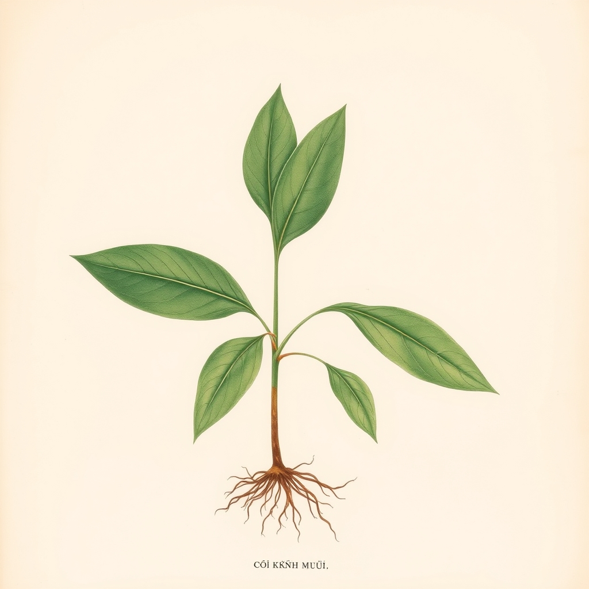

# Bài giảng 004 — Những đường sống trong nước mặn

> Ngày công bố: 27-11-2026  
> Tác giả: Giáo sư Ezekiel Sycamore  
> Mã bài giảng: SS-SYC-20261127-004  
> Công bố chính thức · Chuyên đề một mẫu vật

Tôi chọn Cói Kính Muối để giảng về cách thực vật ven biển quản lý muối, giữ nước và kiến tạo nơi trú ẩn trong hõm triều. Một bụi cỏ nhỏ có thể thay đổi dòng nước, giữ trầm tích và nuôi dưỡng cả một cộng đồng sinh vật.

## I. Thực vật — Cói Kính Muối

### Nhận diện và hình thái

Búi thưa trên cát pha muối; lá hẹp hình dải phủ sáp mờ, mép lá già có thể có tinh thể trắng; thân ngầm ngắn nối chồi. Chỉ lấy mẫu tối thiểu khi được phép; không nếm, đốt hoặc nghiền trong không gian kín. Với sinh vật sống, không phá nơi trú ẩn hay tách cá thể khỏi nền bám chỉ để kiểm tra.

### Ghi chép thực địa

Trong những chuyến khảo sát kéo dài qua nhiều mùa, tôi đã đối chiếu hình thái của mẫu vật với biến đổi của môi trường, dấu vết sinh vật đi kèm và cách cư dân địa phương sử dụng chúng. Chính sự lặp lại của những quan hệ ấy cho phép ta hiểu chức năng thật sự của mẫu vật.

**Tags:** `sycamore-lecture-004` · `field-observation` · `evidence-separated`

## Tổng kết giảng dạy

Mẫu vật chỉ thực sự được hiểu khi đặt vào toàn bộ hệ sinh thái: môi trường tạo nên hình thái, hình thái chi phối cách tồn tại, và cách tồn tại lại làm thay đổi môi trường.

## Chuyên luận: Cói Kính Muối trong hõm triều

Cói Kính Muối sống ở hõm triều nông, nơi nước biển đọng lại sau khi triều xuống. Lớp cutin vi tinh thể khiến nước trượt khỏi lá; muối dư được dẫn về đầu lá già để bảo vệ mô non. Thân rễ bò ngang dưới cát, dự trữ nước và đường trong các đốt phình, giúp cây vượt qua những giờ phơi triều. Búi cói làm chậm dòng nước, giữ cát mịn và tạo khe ẩm cho giáp xác trú ẩn. Ốc ăn tảo trên bẹ lá, cua non ẩn dưới thân rễ, chim lội săn mồi ở rìa bụi. Lá già phơi khô được bện thành tấm lót chống ẩm; khi thu hoạch phải giữ nguyên thân rễ.

### Chu kỳ sống và nhịp triều
Cói Kính Muối sinh trưởng mạnh vào đầu mùa gió ấm. Chồi non mọc từ các đốt thân rễ ngay sau khi lớp cát được triều bồi mới phủ lên. Đến giữa mùa, cây phát cuống hoa ngắn nằm thấp trong bẹ; hạt chín rơi vào hõm nước, có lớp áo nổi giữ chúng trôi quanh búi mẹ trước khi bám vào cát. Thân rễ già hóa gỗ và trở thành khung giữ cát cho thế hệ chồi tiếp theo.

### Quan hệ sinh thái và đời sống cư dân
Búi cói tạo vùng nước yên cho ấu trùng cua, tôm và ốc non. Cá nhỏ săn ấu trùng ở mép búi, chim lội săn cá ở vùng nước mở. Khi các búi nối thành dải, chúng làm giảm sức xói của triều và giữ đường bờ ổn định. Cư dân hõm triều dùng lá già phơi khô làm tấm lót giỏ cá; sợi thân rễ được đan thành dây buộc ngắn, không dùng cho dây neo chịu tải.

### Lời dặn của Sycamore
Muối không chỉ là thứ cây phải chịu đựng. Cói Kính Muối điều khiển đường đi của muối, nước và cát quanh chính nó. Muốn hiểu một loài ven biển, hãy nhìn vào phần bờ biển thay đổi sau khi nó mọc thành quần thể.

## Câu hỏi dành cho học viên

1. Cấu trúc nào của mẫu vật trực tiếp tạo nên lợi thế sinh tồn của nó?
2.
3. Nếu điều kiện môi trường thay đổi mạnh, vai trò sinh thái của mẫu vật sẽ biến đổi ra sao?

---
