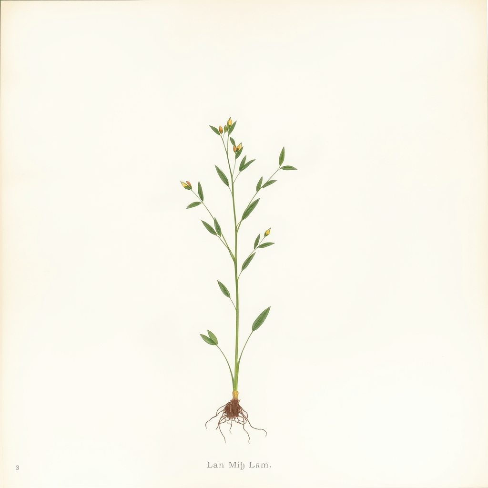

# Bài giảng 006 — Sinh vật của tầng rừng mù

> Ngày công bố: 27-11-2026  
> Tác giả: Giáo sư Ezekiel Sycamore  
> Mã bài giảng: SS-SYC-20261127-006  
> Công bố chính thức · Chuyên đề một mẫu vật

Lan Mũ Kim Lam cho thấy đời sống biểu sinh không phải hình thức ký sinh. Loài lan này sử dụng thân cây như một giá đỡ, thu nước từ sương và dựa vào cộng sinh nấm để hoàn tất vòng đời dưới tầng tán thiếu sáng.

## I. Thực vật — Lan Mũ Kim Lam

### Nhận diện và hình thái

Cây nhỏ bám vỏ gỗ bằng rễ mảnh; lá mọc hai hàng, hình mũi mác ngắn, mặt trên xanh ô liu, mặt dưới nhạt; gốc có mô xốp giữ ẩm. Chỉ lấy mẫu tối thiểu khi được phép; không nếm, đốt hoặc nghiền trong không gian kín. Với sinh vật sống, không phá nơi trú ẩn hay tách cá thể khỏi nền bám chỉ để kiểm tra.

### Ghi chép thực địa

Trong những chuyến khảo sát kéo dài qua nhiều mùa, tôi đã đối chiếu hình thái của mẫu vật với biến đổi của môi trường, dấu vết sinh vật đi kèm và cách cư dân địa phương sử dụng chúng. Chính sự lặp lại của những quan hệ ấy cho phép ta hiểu chức năng thật sự của mẫu vật.

**Tags:** `sycamore-lecture-006` · `field-observation` · `evidence-separated`

## Tổng kết giảng dạy

Mẫu vật chỉ thực sự được hiểu khi đặt vào toàn bộ hệ sinh thái: môi trường tạo nên hình thái, hình thái chi phối cách tồn tại, và cách tồn tại lại làm thay đổi môi trường.

## Chuyên luận: Lan Mũ Kim Lam trên tầng rừng mù

Lan Mũ Kim Lam là thực vật biểu sinh, không hút nhựa cây chủ. Rễ có mô xốp hấp thụ sương và mùn lá; rễ áp vỏ tiết chất bám, rễ lộ ngoài hút hơi ẩm. Chóp lá cứng dẫn nước khỏi đỉnh sinh trưởng, tránh thối nõn trong rừng sương. Hoa nở theo đợt sương dày, thu hút bướm đêm tầng tán. Hạt nhỏ phát tán theo luồng khí ẩm và nảy mầm khi gặp nấm cộng sinh trên vỏ gỗ mục. Cụm rễ giữ nước, tạo vi sinh cảnh cho bọ rêu và ấu trùng. Người làm vườn ghép lan lên gỗ mục xốp, không trồng trong đất đặc.

### Vòng đời và cộng sinh
Lan Mũ Kim Lam bắt đầu đời sống dưới dạng hạt bụi, mang rất ít chất dự trữ. Sợi nấm cộng sinh xâm nhập lớp vỏ mục, chuyển khoáng và đường đơn cho phôi; khi rễ đầu tiên hình thành, lan chuyển dần sang tự quang hợp. Cây trưởng thành ra hoa vào những đợt sương dày, khi bướm đêm tầng tán bay thấp và dễ tìm thấy mùi hương của hoa. Quả nứt thành khe nhỏ, giải phóng hạt theo luồng khí ẩm.

### Vị trí trong tầng rừng
Lan không làm suy kiệt cây chủ. Cụm rễ giữ nước trên vỏ, làm chậm dòng chảy dọc thân cây và tạo nơi trú cho ve, bọ rêu cùng ấu trùng cánh mỏng. Khi cành mục rơi xuống nền rừng, cụm lan và mạng nấm tiếp tục phân hủy gỗ, trả khoáng về đất. Vì vậy, loài lan này nối tầng tán với tầng mục rữa dưới đất.

### Lời dặn của Sycamore
Một cây lan biểu sinh không phải kẻ ăn bám. Hãy phân biệt nơi nó đứng với thứ nó lấy làm thức ăn. Trong rừng mù, quan hệ cộng sinh thường quan trọng hơn sự cạnh tranh trực tiếp.

## Câu hỏi dành cho học viên

1. Cấu trúc nào của mẫu vật trực tiếp tạo nên lợi thế sinh tồn của nó?
2.
3. Nếu điều kiện môi trường thay đổi mạnh, vai trò sinh thái của mẫu vật sẽ biến đổi ra sao?

---
