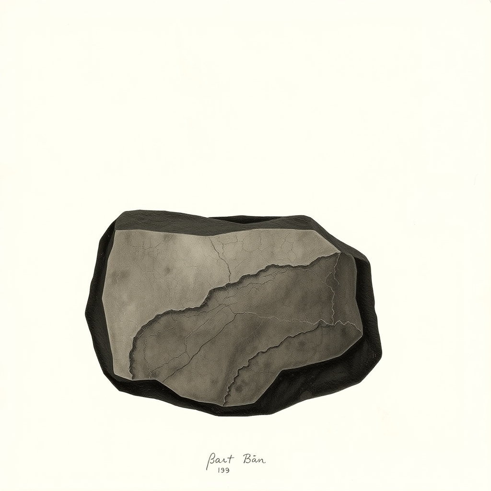

# Bài giảng 007 — Sau lớp tro núi lửa

> Ngày công bố: 27-11-2026  
> Tác giả: Giáo sư Ezekiel Sycamore  
> Mã bài giảng: SS-SYC-20261127-007  
> Công bố chính thức · Chuyên đề một mẫu vật

Đá Bọt Bện lưu giữ hình dạng của một dòng vật chất nóng trong khoảnh khắc nó nguội đi. Từ hướng kéo dài của từng khoang khí, người đọc địa chất có thể tái dựng chuyển động và tốc độ đông cứng của dòng núi lửa.

## I. Khoáng vật / Đá — Đá Bọt Bện

### Nhận diện và hình thái

Mảnh đá sáng màu, nhẹ, nhiều lỗ kéo dài cùng hướng; vách lỗ mỏng nối như mạng; mép vỡ sắc, thân dễ vụn.

### Đặc tính và vai trò sinh thái

Lỗ có thể hình thành khi khí thoát khỏi vật liệu nóng nguội nhanh; hướng lỗ có thể ghi lại dòng chảy hoặc biến dạng. Chỉ lấy mẫu tối thiểu khi được phép; không nếm, đốt hoặc nghiền trong không gian kín. Với sinh vật sống, không phá nơi trú ẩn hay tách cá thể khỏi nền bám chỉ để kiểm tra.

### Ghi chép thực địa

Trong những chuyến khảo sát kéo dài qua nhiều mùa, tôi đã đối chiếu hình thái của mẫu vật với biến đổi của môi trường, dấu vết sinh vật đi kèm và cách cư dân địa phương sử dụng chúng. Chính sự lặp lại của những quan hệ ấy cho phép ta hiểu chức năng thật sự của mẫu vật.

**Tags:** `sycamore-lecture-007` · `field-observation` · `evidence-separated`

## Tổng kết giảng dạy

Mẫu vật chỉ thực sự được hiểu khi đặt vào toàn bộ hệ sinh thái: môi trường tạo nên hình thái, hình thái chi phối cách tồn tại, và cách tồn tại lại làm thay đổi môi trường.

## Chuyên luận: Đá Bọt Bện và dấu tích dòng nóng

Đá Bọt Bện hình thành khi vật chất núi lửa giàu khí nguội nhanh. Dòng chảy kéo bọt khí thành khoang dài song song; vách khoang mỏng giao nhau tạo mạng bện. Hướng lỗ ghi lại hướng dòng chảy cuối cùng, kích thước lỗ phản ánh tốc độ khí thoát và độ nhớt vật chất nóng. Khi mới hình thành, đá nổi tạm thời nhờ khoang kín giữ khí; nước thấm đầy mạng lỗ khiến nó chìm. Bề mặt xốp là nơi địa y và rêu đầu tiên bám vào sau đợt tro bụi. Thợ xây nghiền đá thành hạt nhẹ làm lớp thoát nước, không dùng nguyên khối làm trụ chịu tải.

### Biến đổi sau khi nguội
Khi Đá Bọt Bện mới hình thành, các khoang khí còn kín và đá có khối lượng riêng thấp. Qua nhiều mùa mưa, nước thấm vào các khe nối, mang theo hạt sét và oxit kim loại. Một phần khoang bị lấp, phần khác mở rộng do phong hóa; vì vậy cùng một dòng đá có thể tạo ra những mảnh nhẹ nổi tạm thời và những khối nặng nằm sâu trong lớp tro.

### Tác động lên hệ sinh thái
Bề mặt xốp giữ nước và chất khoáng, là nơi địa y tiên phong bám vào. Rêu mọc sau đó, giữ bụi và tạo mùn; cỏ chịu nhiệt bén rễ trong các hốc lớn. Các khe đá trở thành nơi trú của thằn lằn nhỏ và côn trùng tránh nắng. Đá Bọt Bện vì thế không chỉ là dấu tích núi lửa mà còn là nền móng của quá trình tái sinh sau tro bụi.

### Lời dặn của Sycamore
Một tảng đá là lịch sử của vật chất đã nguội. Hãy đọc hướng lỗ rỗng, độ dày vách và lớp khoáng bám trên thành lỗ; chúng kể về chuyển động, nhiệt và thời gian rõ hơn màu sắc bên ngoài.

## Câu hỏi dành cho học viên

1. Cấu trúc nào của mẫu vật trực tiếp tạo nên lợi thế sinh tồn của nó?
2.
3. Nếu điều kiện môi trường thay đổi mạnh, vai trò sinh thái của mẫu vật sẽ biến đổi ra sao?

---
