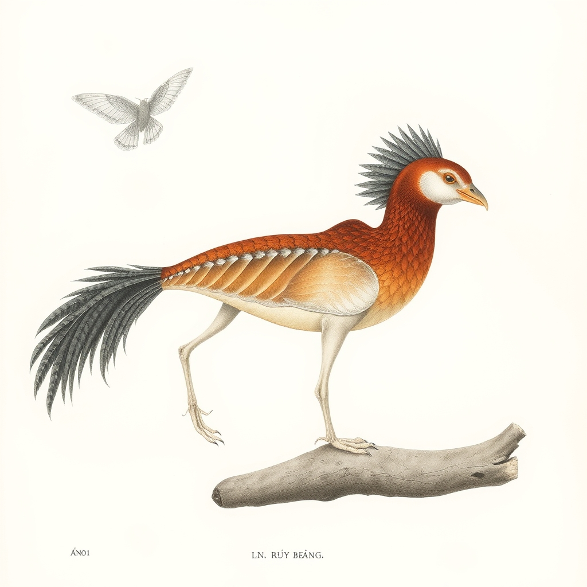

# Bài giảng 008 — Dòng nước trong lòng đá

> Ngày công bố: 27-11-2026  
> Tác giả: Giáo sư Ezekiel Sycamore  
> Mã bài giảng: SS-SYC-20261127-008  
> Công bố chính thức · Chuyên đề một mẫu vật

Lươn Ruy Băng Mù là cư dân của những dòng nước ngầm nơi ánh sáng không thể đi theo. Bài học của loài này nằm ở việc chuyển chức năng định hướng từ thị giác sang cảm nhận rung động, dòng chảy và dấu hóa học trong nước.

## I. Động vật — Lươn Ruy Băng Mù

### Nhận diện và hình thái

Thân dài dẹt nhẹ, trắng ngà pha hồng vùng mang; vây lưng nối vây đuôi thấp; mắt rất nhỏ dưới da, miệng có râu ngắn.

### Đặc tính và vai trò sinh thái

Giữ sát nền đá và phản ứng với rung động nước; gợi ý cảm giác cơ học quan trọng nhưng không chứng minh mất thị giác. Chỉ lấy mẫu tối thiểu khi được phép; không nếm, đốt hoặc nghiền trong không gian kín. Với sinh vật sống, không phá nơi trú ẩn hay tách cá thể khỏi nền bám chỉ để kiểm tra.

### Ghi chép thực địa

Qua nhiều mùa khảo sát, tôi đã đối chiếu hình thái mẫu vật với biến đổi của môi trường, dấu vết sinh vật đi kèm và cách cư dân địa phương sử dụng chúng. Những quan hệ lặp lại ấy cho thấy mẫu vật là một phần vận hành của hệ sinh thái, không phải một hình thể đứng riêng.

**Tags:** `sycamore-lecture-008` · `field-observation` · `evidence-separated`

## Tổng kết giảng dạy

Mẫu vật chỉ thực sự được hiểu khi đặt vào toàn bộ hệ sinh thái: môi trường tạo nên hình thái, hình thái chi phối cách tồn tại, và cách tồn tại lại làm thay đổi môi trường.

## Chuyên luận: Lươn Ruy Băng Mù trong dòng ngầm

Thân dẹt hai bên giúp lươn giữ vị trí trong khe nước hẹp; vây lưng và vây hậu môn nối thành dải đẩy liên tục, cho phép tiến lùi mà không xoay thân. Mắt tiêu giảm trong bóng tối, nhưng đường bên phát triển thành dải thụ cảm rung động; râu quanh miệng nhận biết mùi khoáng và dấu hóa học của con mồi. Lươn ăn tôm hang, ấu trùng côn trùng nước và trứng cá trong khe. Trứng được đặt ở hốc có dòng chảy nhẹ; con non bám đá bằng miệng hút trước khi chuyển sang săn mồi. Sự hiện diện của lươn là dấu hiệu mạch nước ngầm ổn định và giàu oxy.

## Chuyên luận: Lươn Ruy Băng Mù

Thân dẹt hai bên giúp lươn giữ vị trí trong khe nước hẹp; vây lưng và vây hậu môn nối thành dải đẩy liên tục, cho phép tiến lùi mà không xoay thân. Mắt tiêu giảm trong bóng tối, nhưng đường bên phát triển thành dải thụ cảm rung động; râu quanh miệng nhận biết mùi khoáng và dấu hóa học của con mồi. Lươn ăn tôm hang, ấu trùng côn trùng nước và trứng cá trong khe. Trứng được đặt ở hốc có dòng chảy nhẹ; con non bám đá bằng miệng hút trước khi chuyển sang săn mồi. Sự hiện diện của lươn là dấu hiệu mạch nước ngầm ổn định và giàu oxy.

### Săn mồi và sinh sản
Lươn Ruy Băng Mù thường nằm ngược dòng ở sau các gờ đá, nơi dòng nước mang mùi của con mồi đến trước khi con mồi xuất hiện. Khi phát hiện rung động, nó uốn thân thành chữ S rồi phóng ngược dòng trong một nhịp ngắn. Trứng được đặt thành cụm trong hốc có dòng chảy vừa đủ để đưa oxy đến mà không cuốn trứng đi. Con non sống nhờ túi noãn hoàng, bám đá bằng miệng hút trước khi bắt đầu săn ấu trùng.

### Vai trò trong lòng đất
Lươn giữ quần thể tôm hang và ấu trùng côn trùng ở mức cân bằng, ngăn chúng phủ kín các màng vi sinh trên đá. Chất thải của lươn nuôi vi khuẩn phân giải khoáng và tạo nguồn thức ăn cho sinh vật nhỏ hơn. Các cộng đồng sống quanh mạch nước vì vậy phụ thuộc vào dòng chảy ổn định cũng như sự hiện diện của loài săn mồi này.

### Lời dặn của Sycamore
Trong bóng tối, âm thanh và rung động là địa hình. Người đi hang phải học cách đọc tiếng nước, bởi một thay đổi nhỏ trong nhịp chảy thường báo trước một khe sụt hoặc một dòng phụ mới mở.

## Câu hỏi dành cho học viên

1. Cấu trúc nào của mẫu vật trực tiếp tạo nên lợi thế sinh tồn của nó?
2.
3. Nếu điều kiện môi trường thay đổi mạnh, vai trò sinh thái của mẫu vật sẽ biến đổi ra sao?

---
