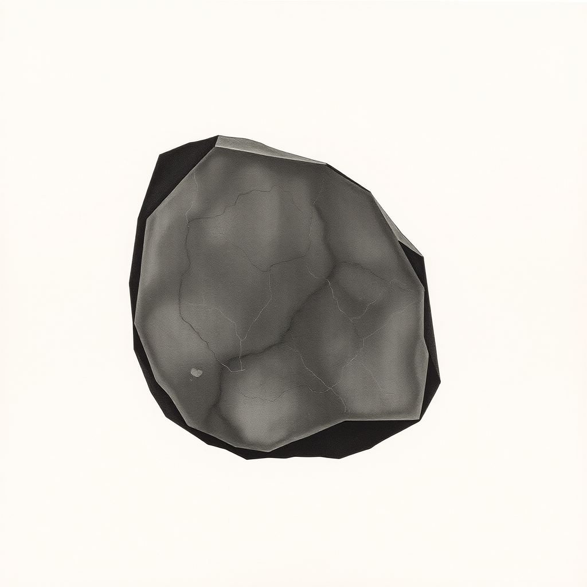

# Bài giảng 011 — Nước nóng và những tầng khoáng

> Ngày công bố: 27-11-2026  
> Tác giả: Giáo sư Ezekiel Sycamore  
> Mã bài giảng: SS-SYC-20261127-011  
> Công bố chính thức · Chuyên đề một mẫu vật

Vôi Bậc Nhiệt ghi lại hành trình của nước nóng từ lòng đất lên mặt. Mỗi bậc kết tinh là một lát cắt của nhiệt độ, tốc độ dòng và thành phần khoáng, đồng thời tạo nên một hệ sinh thái chịu nhiệt độc đáo.

## I. Khoáng vật / Đá — Vôi Bậc Nhiệt

### Nhận diện và hình thái

Mẫu trắng kem có lớp mỏng xếp bậc; vài tầng nhẵn, tầng khác xốp có lỗ nhỏ; cấu trúc lớp tiếp tục bên trong.

### Đặc tính và vai trò sinh thái

Vôi Bậc Nhiệt hình thành khi nước giàu khoáng thoát khí, nguội dần và kết tủa dọc mép dòng. Nhiệt độ, độ axit và tốc độ chảy quyết định kích thước tinh thể cũng như màu của từng tầng. Khi lấy mẫu, chỉ tách mảnh rời ở bậc đã nguội; tránh miệng phun và các lớp vỏ mỏng che dòng nước nóng.

### Ghi chép thực địa

Qua nhiều mùa khảo sát, tôi đã đối chiếu hình thái mẫu vật với biến đổi của môi trường, dấu vết sinh vật đi kèm và cách cư dân địa phương sử dụng chúng. Những quan hệ lặp lại ấy cho thấy mẫu vật là một phần vận hành của hệ sinh thái, không phải một hình thể đứng riêng.

**Tags:** `sycamore-lecture-011` · `field-observation` · `evidence-separated`

## Tổng kết giảng dạy

Mẫu vật chỉ thực sự được hiểu khi đặt vào toàn bộ hệ sinh thái: môi trường tạo nên hình thái, hình thái chi phối cách tồn tại, và cách tồn tại lại làm thay đổi môi trường.

## Chuyên luận: Vôi Bậc Nhiệt

Vôi Bậc Nhiệt kết tinh quanh mạch nước nóng giàu khoáng khi nước trồi lên và nguội dần theo từng bậc. Lớp sát miệng phun có tinh thể mịn; lớp ở bậc thấp kết tinh thành phiến dày. Vệt xanh lục, vàng nhạt và nâu đỏ hình thành do kim loại hòa tan kết tủa theo nhiệt độ và độ axit. Mạch nóng vận chuyển khoáng từ sâu trong đất, tạo gờ đá mới và đổi hướng lòng suối. Màng vi khuẩn chịu nhiệt nuôi côn trùng suối; côn trùng thu hút chim nhỏ và thằn lằn đá. Vôi trắng được nung thành bột kết dính cho vữa chống ẩm; lớp giàu kim loại được tách riêng.

### Nhịp kết tinh và cấu trúc tầng
Mỗi đợt nước nóng tràn qua bậc đá để lại một lớp khoáng mỏng. Khi dòng chảy mạnh, tinh thể kéo dài theo hướng nước; khi dòng yếu, chúng phát triển thành hạt dày và sít. Các lớp chồng lên nhau như vòng sinh trưởng của cây, lưu dấu những giai đoạn mạch nước dâng, hạ và đổi thành phần. Người thợ đọc mặt cắt của tầng vôi để tìm đường nước nóng ổn định và vị trí khoáng có độ tinh khiết cao.

### Sinh vật chịu nhiệt
Màng vi sinh bám trên bậc ấm tiết chất nhầy giữ khoáng và tạo bề mặt cho ấu trùng côn trùng bám. Côn trùng trưởng thành bay ra khỏi vùng hơi nước vào lúc chiều mát, trở thành thức ăn cho thằn lằn đá và chim suối. Các loài này tạo nên một chuỗi thức ăn ngắn nhưng có năng suất cao quanh mạch nóng.

### Lời dặn của Sycamore
Không bước lên lớp vôi trắng chỉ vì nó trông khô. Lớp vỏ mỏng thường che dòng nước sôi bên dưới. Hãy đọc màu khoáng, hơi nước và tiếng chảy trước khi chọn đường đi.

## Câu hỏi dành cho học viên

1. Cấu trúc nào của mẫu vật trực tiếp tạo nên lợi thế sinh tồn của nó?
2.
3. Nếu điều kiện môi trường thay đổi mạnh, vai trò sinh thái của mẫu vật sẽ biến đổi ra sao?

---
