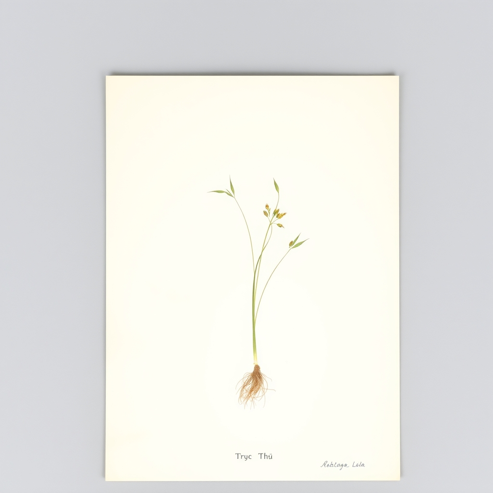

# Bài giảng 013 — Ranh giới giữa rừng và đầm lầy

> Ngày công bố: 27-11-2026  
> Tác giả: Giáo sư Ezekiel Sycamore  
> Mã bài giảng: SS-SYC-20261127-013  
> Công bố chính thức · Chuyên đề một mẫu vật

Trúc Rễ Thở phát triển ở ranh giới nơi đất rừng chuyển thành đầm ngập. Hệ thống mô khí trong thân và rễ phụ nhô khỏi bùn cho phép cây duy trì trao đổi khí, đồng thời giữ đất và tạo hành lang trú ẩn cho sinh vật đầm lầy.

## I. Thực vật — Trúc Rễ Thở

### Ghi chép thực địa

Qua nhiều mùa khảo sát, tôi đã đối chiếu hình thái mẫu vật với biến đổi của môi trường, dấu vết sinh vật đi kèm và cách cư dân địa phương sử dụng chúng. Những quan hệ lặp lại ấy cho thấy mẫu vật là một phần vận hành của hệ sinh thái, không phải một hình thể đứng riêng.

**Tags:** `sycamore-lecture-013` · `field-observation` · `evidence-separated`

## Tổng kết giảng dạy

Mẫu vật chỉ thực sự được hiểu khi đặt vào toàn bộ hệ sinh thái: môi trường tạo nên hình thái, hình thái chi phối cách tồn tại, và cách tồn tại lại làm thay đổi môi trường.

## Chuyên luận: Trúc Rễ Thở

Thân rỗng chia đốt của Trúc Rễ Thở chứa mô khí dẫn oxy từ lá xuống hệ rễ. Rễ phụ mọc ngược khỏi bùn có lớp vỏ xốp và lỗ trao đổi khí; khi nước dâng, phần rễ nhô trên mặt nước vẫn thông khí cho rễ chìm. Khi đất khô, rễ phụ co lại để giảm thoát hơi. Thân rễ lan ngang giữ bùn, làm chậm dòng tràn từ rừng xuống đầm. Lá rụng nuôi nấm và côn trùng nước; cá nhỏ trú trong hốc rễ, chim lội săn mồi ở mép bụi. Thân trưởng thành dùng làm cọc nhẹ và ống dẫn nước ngắn sau khi phơi khô; phải giữ lại thân rễ để bờ đầm không mất lớp neo tự nhiên.

### Cấu trúc rễ và điều tiết nước
Rễ thở của Trúc Rễ Thở mọc thành cụm quanh gốc, các ống khí nối với khoang thân qua những mô dẫn rỗng. Khi bùn ngập, oxy đi từ lá xuống rễ chìm; khi nước rút, các lỗ trên rễ phụ trao đổi khí trực tiếp với không khí. Rễ non mềm và sáng màu, rễ già hóa gỗ, trở thành cọc giữ bùn. Cấu trúc này cho phép cây chịu được nhịp ngập-rút lặp lại mà không cần chuyển toàn bộ hệ rễ lên nền cao.

### Vai trò ở ranh giới sinh cảnh
Bụi trúc làm chậm dòng nước từ rừng đổ vào đầm, giữ phù sa và tạo những hành lang nước nông cho cá non. Chim lội săn cá ở rìa bụi; rắn nước và cua trú trong khoảng rỗng giữa các rễ. Lá rụng phân hủy chậm trong bùn, bổ sung mùn và duy trì quần thể nấm chịu ngập. Khi bụi trúc nối thành dải, ranh giới rừng-đầm trở thành vùng chuyển tiếp giàu sinh vật thay vì một đường phân chia sắc nét.

### Lời dặn của Sycamore
Ranh giới sinh thái là nơi hai thế giới trao đổi vật chất, không phải bức tường ngăn cách. Muốn hiểu đầm lầy, hãy nghiên cứu cả khu rừng đang nuôi dưỡng nó.

## Câu hỏi dành cho học viên

1. Cấu trúc nào của mẫu vật trực tiếp tạo nên lợi thế sinh tồn của nó?
2.
3. Nếu điều kiện môi trường thay đổi mạnh, vai trò sinh thái của mẫu vật sẽ biến đổi ra sao?

---
